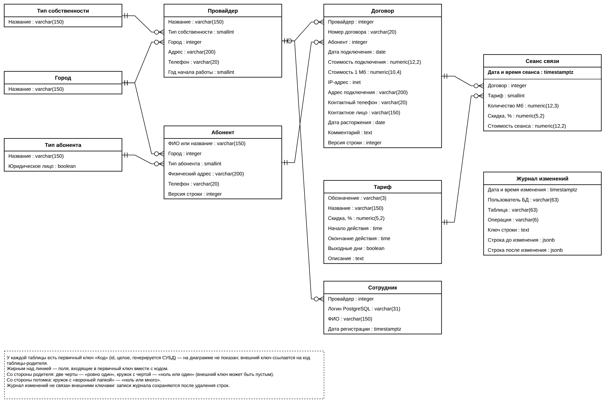

# 4 Проектирование базы данных в выбранной СУБД

<!-- Черновик. Что писать: 4.1 Концептуальная модель (ЛР 2); 4.2 Таблицы, домены, индексы, сиквенсы (ЛР 3); 4.3 Триггеры; 4.4 Многоролевой доступ; 4.5 RLS; 4.6 Партицирование (ЛР 8); 4.7 Проектирование запросов (ЛР 5–6); 4.8 Представления, процедуры, функции. -->

## 4.1 Концептуальная модель базы данных

<!-- По итогам ЛР 2. Полная версия — labs/lab02/model.md; сюда — сжатый вариант. После ЛР 3 таблицы полей заменить сгенерированными из фактической схемы (COMMENT ON). -->

Модель построена по методике IDEF1X. Исходное отношение, содержащее все сведения задания в одной таблице сеансов, приводит к аномалиям обновления (смена телефона провайдера требует изменения всех строк его сеансов), включения (невозможно зарегистрировать провайдера без сеансов) и удаления (удаление последнего сеанса уничтожает сведения о договоре). Последовательное приведение к 1НФ (атомарность значений, развёртывание повторяющейся группы сеансов), 2НФ (устранение зависимостей реквизитов провайдера и договора от части составного ключа) и 3НФ (вынесение абонента и тарифа, от которых транзитивно зависят реквизиты абонента и скидка) даёт восемь сущностей предметной области.

Справочники: тип собственности, город, тип абонента, тариф. Базовые таблицы: провайдер, абонент, договор, сеанс связи. Абоненты образуют общий реестр объединения: одно лицо или предприятие, обслуживаемое несколькими провайдерами, представлено одной записью, а дубли исключает уникальность наименования (без учёта регистра) вместе с цифрами телефона. Провайдер и абонент связаны «многие ко многим» через договор — таблицу пересечения, в которой, кроме номера, цен и IP-адреса, хранятся сведения, различающиеся у разных провайдеров: адрес подключения, контактный телефон и контактное лицо. Для требований к системе добавлены две служебные таблицы: «Сотрудник» связывает учётную запись PostgreSQL с провайдером для разграничения доступа к строкам (паролей и ролей таблица не содержит — роль определяется членством в группе PostgreSQL), «Журнал изменений» хранит версии изменённых строк в формате `jsonb` и внешними ключами не связан, чтобы записи сохранялись после удаления строк. Таблицы базы данных и связи между ними показаны на рисунке [@fig:pz-er-logical].

{#fig:pz-er-logical}

Описание связей приведено в таблице [@tab:pz-relations].

Таблица: Связи между сущностями {#tab:pz-relations}

| № | Родитель | Потомок | Мощность | При удалении родителя |
|---|---|---|---|---|
| R1 | Тип собственности | Провайдер | 1 : 0..N | запрет |
| R2 | Город | Провайдер | 1 : 0..N | запрет |
| R3 | Город | Абонент | 1 : 0..N | запрет |
| R4 | Тип абонента | Абонент | 1 : 0..N | запрет |
| R5 | Провайдер | Договор | 1 : 0..N | запрет |
| R6 | Абонент | Договор | 1 : 0..N | каскадное удаление |
| R7 | Договор | Сеанс | 1 : 0..N | каскадное удаление |
| R8 | Тариф | Сеанс | 1 : 0..N | запрет |
| R9 | Провайдер | Сотрудник | 0..1 : 0..N | запрет |

Первичные ключи всех таблиц — суррогатные целочисленные, генерируемые СУБД. Естественные ключи сохранены как альтернативные: название провайдера и наименования в справочниках уникальны, номер договора уникален в пределах провайдера, IP-адрес уникален среди действующих договоров провайдера (частичный уникальный индекс). Первичный ключ таблицы сеансов составной — {идентификатор, дата и время сеанса}, так как таблица секционирована по дате сеанса (подраздел 4.6), а PostgreSQL требует включения ключа секционирования в первичный ключ.

Повторяющиеся ограничения значений оформлены доменами: наименование, адрес, телефон, год, номер договора, денежная сумма (`numeric(12,2)`), стоимость 1 Мб (`numeric(10,4)`), процент скидки, объём в мегабайтах. Денежные величины хранятся в типе `numeric`, исключающем ошибки двоичного округления; IP-адрес — во встроенном типе `inet`; дата и время сеанса — в `timestamptz`.

Модель содержит обоснованную денормализацию: в сеансе хранятся скидка тарифа и стоимость сеанса на момент его регистрации. Скидка транзитивно зависит от тарифа, а стоимость вычисляется из объёма, цены договора и скидки, однако изменение справочника тарифов или условий договора не должно менять стоимость уже оказанных услуг, а отчёты о выручке по сотням тысяч сеансов не должны пересчитывать стоимость с соединением трёх таблиц. Значения заполняются триггером при вставке сеанса и не редактируются, поэтому аномалии обновления не возникают.

## 4.2 Таблицы, домены, индексы, последовательности

<!-- По итогам ЛР 3. Исходники — db/migrations/010…050, db/seed/, проверки — db/tests/010_structure.sql. Блок между метками schema2md пересобирается командой python tools/schema2md.py --update coursework/pz/40-bd.md после любых изменений схемы. -->

База данных `superbd` создана в кодировке UTF-8 и разделена на схемы по назначению: `ref` — справочники и домены, `core` — основные таблицы предметной области, `sec` — сотрудники и функции разграничения доступа, `audit` — журнал изменений, `api` — функции и представления, через которые работает клиентское приложение. Все объекты принадлежат роли `app_owner`, у которой нет права входа в систему; права на схемы у роли PUBLIC отозваны, а группам пользователей выдаётся доступ только к схеме `api`.

Структура создаётся последовательностью сценариев миграции (приложение Б), которые выполняются по порядку из сценария `db/build.sql`: схемы и группы пользователей, домены, справочники, основные таблицы, триггер проверки логина сотрудника, индексы, после чего таблицы заполняются данными. Таблицы создаются в порядке «сначала сторона «один», затем подчинённые»: справочники, провайдер и абонент, договор, сеанс связи, затем служебные таблицы. Каждый сценарий можно выполнить повторно без ошибок.

Для каждой таблицы и колонки задан комментарий (`COMMENT ON`) с названием из концептуальной модели; совпадение комментариев с полями модели проверяется сценарием `tools/drawio/check_concept_vs_db.py`. Первичные ключи — суррогатные, генерируются СУБД (`GENERATED ALWAYS AS IDENTITY`). Ограничения значений заданы доменами и проверочными ограничениями: дата расторжения договора не раньше даты подключения, время начала и окончания действия тарифа задаются вместе. Проверки, зависящие от текущей даты и других таблиц (сеанс в периоде действия договора, подключение не раньше года основания провайдера, неизменность сторон договора), реализуются триггерами (подраздел 4.3).

Связи между таблицами реализованы внешними ключами с явно выбранным правилом удаления (таблица [@tab:pz-relations]). Внешних ключей на системные таблицы PostgreSQL поставить нельзя, поэтому соответствие логина сотрудника существующей учётной записи PostgreSQL проверяет триггер `trg_app_user_biu_check_role`. Своей таблицы пользователей в базе нет: пользователи и группы хранятся в системных таблицах `pg_authid` и `pg_auth_members` и создаются командами `CREATE ROLE` и `GRANT`. Схема данных, построенная в pgAdmin по фактической базе, показана на рисунке [@fig:pz-erd-pgadmin].

{#fig:pz-erd-pgadmin}

Свойства колонок основных таблиц в режиме конструктора показаны на рисунках [@fig:pz-contract-columns] и [@fig:pz-session-columns], справочников — на рисунках [@fig:pz-tariff-columns] и [@fig:pz-subscriber-type-columns].

{#fig:pz-contract-columns}

{#fig:pz-session-columns}

{#fig:pz-tariff-columns}

{#fig:pz-subscriber-type-columns}

Кроме индексов, которые PostgreSQL создаёт для первичных ключей и ограничений уникальности, проиндексированы все внешние ключи (ускоряют соединения и проверку ссылок при удалении родительской строки), дата и время сеанса и пара «договор, дата сеанса» для выборок за период, дата подключения договора, а также пара «абонент, провайдер» договора, по которой проверяется, есть ли у провайдера договор с абонентом. Уникальный индекс по выражениям «`lower(name)` с классом операторов `text_pattern_ops`, цифры телефона» не допускает повторной записи абонента и одновременно служит для поиска абонента по началу наименования без учёта регистра. Уникальность IP-адреса среди действующих договоров провайдера обеспечивает частичный уникальный индекс с условием `closed_on IS NULL`.

Номер договора по умолчанию формируется из явной последовательности `core.contract_no_seq` в виде «Д-<год>-<шестизначный номер>»; остальные последовательности созданы СУБД для колонок идентификаторов.

Таблицы заполнены сценариями `db/seed/`: справочники — осмысленными значениями (от 10 до 12 записей), основные таблицы — псевдослучайными данными, сгенерированными средствами SQL (`generate_series`, `random()` с фиксированным начальным значением `setseed`, поэтому результат воспроизводим): 30 провайдеров, 8 000 абонентов, 12 000 договоров и 100 000 сеансов связи — всего более 120 000 строк. Генератор соблюдает ограничения предметной области: сеансы попадают в период действия договора, тариф выбирается по времени сеанса и типу дня, стоимость сеанса вычисляется по формуле; 5 % абонентов не имеют договоров, а два тарифа не имеют сеансов — это нужно для демонстрации внешних соединений. Корректность структуры и данных проверяется набором тестов `db/tests/` (26 проверок).

<!-- BEGIN schema2md -->
Домены приведены в таблице [@tab:pz-domains], структура таблиц — в таблицах [@tab:pz-ownership-type] – [@tab:pz-change-log], индексы — в таблице [@tab:pz-indexes], последовательности — в таблице [@tab:pz-sequences]. Таблицы сформированы по фактической схеме базы данных (комментарии COMMENT ON и системный каталог) сценарием `tools/schema2md.py`.

Таблица: Домены {#tab:pz-domains}

| Домен | Базовый тип | Ограничение | Описание |
|---|---|---|---|
| `d_address` | varchar(200) | `(btrim(VALUE) <> '')` | Адрес в пределах города: непустая строка |
| `d_contract_no` | varchar(20) | `((VALUE = btrim(VALUE)) AND (VALUE <> ''))` | Номер договора: непустая строка без пробелов по краям |
| `d_login` | varchar(31) | `((length(VALUE) >= 3) AND (translate("left"(VALUE, 1), 'abcdefghijklmnopqrstuvwxyz', '') = '') AND (translate(VALUE, 'abcdefghijklmnopqrstuvwxyz0123456789_', '') = ''))` | Логин сотрудника — имя LOGIN-роли PostgreSQL: латиница в нижнем регистре, цифры, «_», 3–31 символ |
| `d_mb` | numeric(12,3) | `(VALUE > 0)` | Объём информации, Мб: больше 0 |
| `d_money` | numeric(12,2) | `(VALUE >= 0)` | Денежная сумма, руб.: не меньше 0, два знака после запятой |
| `d_name` | varchar(150) | `((VALUE = btrim(VALUE)) AND (VALUE <> ''))` | Наименование: непустая строка без пробелов по краям |
| `d_percent` | numeric(5,2) | `((VALUE >= 0) AND (VALUE <= 100))` | Процент от 0 до 100 |
| `d_phone` | varchar(20) | `((translate(VALUE, '+0123456789 ()-', '') = '') AND (strpos(substr(VALUE, 2), '+') = 0) AND (length(ltrim(VALUE, '+')) >= 7))` | Телефон: цифры, пробелы, скобки, дефис, необязательный «+» в начале; 7–20 символов |
| `d_price_mb` | numeric(10,4) | `(VALUE > 0)` | Стоимость 1 Мб, руб.: больше 0, четыре знака после запятой |
| `d_year` | smallint | `((VALUE >= 1970) AND (VALUE <= 2100))` | Год от 1970 до 2100 (не позже текущего — проверка триггером) |

Таблица: Структура таблицы «Тип собственности» (ref.ownership_type) {#tab:pz-ownership-type}

| Колонка | Тип | NULL | Ключ | По умолчанию | Описание |
|---|---|---|---|---|---|
| `id` | `smallint` | NOT NULL | PK | `identity` | Код типа собственности |
| `name` | `d_name` | NOT NULL | AK |  | Тип собственности |

Таблица: Структура таблицы «Город» (ref.city) {#tab:pz-city}

| Колонка | Тип | NULL | Ключ | По умолчанию | Описание |
|---|---|---|---|---|---|
| `id` | `integer` | NOT NULL | PK | `identity` | Код города |
| `name` | `d_name` | NOT NULL | AK |  | Город |

Таблица: Структура таблицы «Тип абонента» (ref.subscriber_type) {#tab:pz-subscriber-type}

| Колонка | Тип | NULL | Ключ | По умолчанию | Описание |
|---|---|---|---|---|---|
| `id` | `smallint` | NOT NULL | PK | `identity` | Код типа абонента |
| `name` | `d_name` | NOT NULL | AK |  | Тип абонента |
| `is_legal` | `boolean` | NOT NULL |  | `false` | Юридическое лицо |

Таблица: Структура таблицы «Тариф» (ref.tariff) {#tab:pz-tariff}

| Колонка | Тип | NULL | Ключ | По умолчанию | Описание |
|---|---|---|---|---|---|
| `id` | `smallint` | NOT NULL | PK | `identity` | Код тарифа |
| `code` | `varchar(3)` | NOT NULL | AK |  | Обозначение |
| `name` | `d_name` | NOT NULL | AK |  | Тариф |
| `discount_pct` | `d_percent` | NOT NULL |  | `0` | Скидка, % |
| `time_from` | `time without time zone` | NULL |  |  | Начало действия |
| `time_to` | `time without time zone` | NULL |  |  | Окончание действия |
| `is_weekend` | `boolean` | NULL |  |  | Выходные дни |
| `description` | `text` | NULL |  |  | Описание |

Таблица: Структура таблицы «Провайдер» (core.provider) {#tab:pz-provider}

| Колонка | Тип | NULL | Ключ | По умолчанию | Описание |
|---|---|---|---|---|---|
| `id` | `integer` | NOT NULL | PK | `identity` | Код провайдера |
| `name` | `d_name` | NOT NULL | AK |  | Название |
| `ownership_type_id` | `smallint` | NOT NULL | FK |  | Код типа собственности |
| `city_id` | `integer` | NOT NULL | FK |  | Код города |
| `address` | `d_address` | NOT NULL |  |  | Адрес |
| `phone` | `d_phone` | NOT NULL |  |  | Телефон |
| `founded_year` | `d_year` | NOT NULL |  |  | Год начала работы |

Таблица: Структура таблицы «Абонент» (core.subscriber) {#tab:pz-subscriber}

| Колонка | Тип | NULL | Ключ | По умолчанию | Описание |
|---|---|---|---|---|---|
| `id` | `integer` | NOT NULL | PK | `identity` | Код абонента |
| `name` | `d_name` | NOT NULL |  |  | ФИО или название предприятия |
| `city_id` | `integer` | NOT NULL | FK |  | Код города |
| `subscriber_type_id` | `smallint` | NOT NULL | FK |  | Код типа абонента |
| `address` | `d_address` | NOT NULL |  |  | Физический адрес |
| `phone` | `d_phone` | NOT NULL |  |  | Телефон |
| `row_version` | `integer` | NOT NULL |  | `1` | Версия строки |

Таблица: Структура таблицы «Договор» (core.contract) {#tab:pz-contract}

| Колонка | Тип | NULL | Ключ | По умолчанию | Описание |
|---|---|---|---|---|---|
| `id` | `integer` | NOT NULL | PK | `identity` | Код договора |
| `provider_id` | `integer` | NOT NULL | AK, FK |  | Код провайдера |
| `contract_no` | `d_contract_no` | NOT NULL | AK | `((('Д-' \|\| to_char((CURRENT_DATE), 'YYYY')) \|\| '-') \|\| lpad((nextval('core.contract_no_seq'::regclass)), 6, '0'))` | Номер договора |
| `subscriber_id` | `integer` | NOT NULL | FK |  | Код абонента |
| `connected_on` | `date` | NOT NULL |  | `CURRENT_DATE` | Дата подключения |
| `connection_fee` | `d_money` | NOT NULL |  |  | Стоимость подключения |
| `price_per_mb` | `d_price_mb` | NOT NULL |  |  | Стоимость 1 Мб |
| `ip_address` | `inet` | NOT NULL |  |  | IP-адрес |
| `connection_address` | `d_address` | NOT NULL |  |  | Адрес подключения |
| `contact_phone` | `d_phone` | NULL |  |  | Контактный телефон |
| `contact_person` | `d_name` | NULL |  |  | Контактное лицо |
| `closed_on` | `date` | NULL |  |  | Дата расторжения |
| `note` | `text` | NULL |  |  | Комментарий |
| `row_version` | `integer` | NOT NULL |  | `1` | Версия строки |

Таблица: Структура таблицы «Сеанс связи» (core.session) {#tab:pz-session}

| Колонка | Тип | NULL | Ключ | По умолчанию | Описание |
|---|---|---|---|---|---|
| `id` | `bigint` | NOT NULL | PK | `identity` | Код сеанса |
| `started_at` | `timestamp with time zone` | NOT NULL | PK |  | Дата и время сеанса |
| `contract_id` | `integer` | NOT NULL | FK |  | Код договора |
| `tariff_id` | `smallint` | NOT NULL | FK |  | Код тарифа |
| `volume_mb` | `d_mb` | NOT NULL |  |  | Количество Мб |
| `discount_pct` | `d_percent` | NOT NULL |  |  | Скидка, % |
| `cost` | `d_money` | NOT NULL |  |  | Стоимость сеанса |

Таблица: Структура таблицы «Сотрудник» (sec.app_user) {#tab:pz-app-user}

| Колонка | Тип | NULL | Ключ | По умолчанию | Описание |
|---|---|---|---|---|---|
| `id` | `integer` | NOT NULL | PK | `identity` | Код сотрудника |
| `provider_id` | `integer` | NULL | FK |  | Код провайдера |
| `login` | `d_login` | NOT NULL | AK |  | Логин |
| `full_name` | `d_name` | NOT NULL |  |  | ФИО |
| `created_at` | `timestamp with time zone` | NOT NULL |  | `now()` | Дата регистрации |
| `reset_pending` | `boolean` | NOT NULL |  | `false` | Выдан временный пароль |
| `reset_at` | `timestamp with time zone` | NULL |  |  | Когда выдан временный пароль |
| `reset_by` | `d_login` | NULL |  |  | Кто выдал временный пароль |

Таблица: Структура таблицы «Журнал изменений» (audit.change_log) {#tab:pz-change-log}

| Колонка | Тип | NULL | Ключ | По умолчанию | Описание |
|---|---|---|---|---|---|
| `id` | `bigint` | NOT NULL | PK | `identity` | Код записи |
| `changed_at` | `timestamp with time zone` | NOT NULL |  | `now()` | Дата и время изменения |
| `db_user` | `varchar(63)` | NOT NULL |  | `SESSION_USER` | Пользователь БД |
| `table_name` | `varchar(63)` | NOT NULL |  |  | Таблица |
| `operation` | `varchar(6)` | NOT NULL |  |  | Операция |
| `row_pk` | `text` | NOT NULL |  |  | Ключ строки |
| `old_row` | `jsonb` | NULL |  |  | Строка до изменения |
| `new_row` | `jsonb` | NULL |  |  | Строка после изменения |

Таблица: Индексы {#tab:pz-indexes}

| Индекс | Таблица | Колонки и условие | Вид | Назначение |
|---|---|---|---|---|
| `pk_change_log` | `audit.change_log` | `(id)` | первичный ключ |  |
| `pk_contract` | `core.contract` | `(id)` | первичный ключ |  |
| `uq_contract_provider_id_contract_no` | `core.contract` | `(provider_id, contract_no)` | уникальный |  |
| `uq_contract_provider_id_ip_address_active` | `core.contract` | `(provider_id, ip_address) WHERE (closed_on IS NULL)` | уникальный | IP-адрес уникален среди действующих договоров провайдера (D1) |
| `ix_contract_provider_id_connected_on` | `core.contract` | `(provider_id, connected_on)` |  | Договоры провайдера, заключённые в периоде |
| `ix_contract_subscriber_id_provider_id` | `core.contract` | `(subscriber_id, provider_id)` |  | Договоры абонента; есть ли у абонента договор с провайдером (видимость абонента, D25) |
| `pk_provider` | `core.provider` | `(id)` | первичный ключ |  |
| `uq_provider_name` | `core.provider` | `name` | уникальный |  |
| `ix_provider_city_id` | `core.provider` | `(city_id)` |  | Индекс внешнего ключа |
| `ix_provider_ownership_type_id` | `core.provider` | `(ownership_type_id)` |  | Индекс внешнего ключа |
| `pk_session` | `core.session` | `(id, started_at)` | первичный ключ |  |
| `ix_session_contract_id_started_at` | `core.session` | `(contract_id, started_at)` |  | Сеансы договора за период |
| `ix_session_started_at` | `core.session` | `(started_at)` |  | Сеансы за период (ключ будущего секционирования) |
| `ix_session_tariff_id` | `core.session` | `(tariff_id)` |  | Индекс внешнего ключа |
| `pk_subscriber` | `core.subscriber` | `(id)` | первичный ключ |  |
| `uq_subscriber_lower_name_phone_digits` | `core.subscriber` | `(lower(name) text_pattern_ops, translate((phone), '+ ()-', ''))` | уникальный | Абонент в реестре один (наименование без учёта регистра + цифры телефона, D25); поиск по началу наименования |
| `ix_subscriber_city_id` | `core.subscriber` | `(city_id)` |  | Индекс внешнего ключа |
| `ix_subscriber_subscriber_type_id` | `core.subscriber` | `(subscriber_type_id)` |  | Индекс внешнего ключа |
| `pk_city` | `ref.city` | `(id)` | первичный ключ |  |
| `uq_city_name` | `ref.city` | `name` | уникальный |  |
| `pk_ownership_type` | `ref.ownership_type` | `(id)` | первичный ключ |  |
| `uq_ownership_type_name` | `ref.ownership_type` | `name` | уникальный |  |
| `pk_subscriber_type` | `ref.subscriber_type` | `(id)` | первичный ключ |  |
| `uq_subscriber_type_name` | `ref.subscriber_type` | `name` | уникальный |  |
| `pk_tariff` | `ref.tariff` | `(id)` | первичный ключ |  |
| `uq_tariff_code` | `ref.tariff` | `(code)` | уникальный |  |
| `uq_tariff_name` | `ref.tariff` | `name` | уникальный |  |
| `pk_app_user` | `sec.app_user` | `(id)` | первичный ключ |  |
| `uq_app_user_login` | `sec.app_user` | `(login)` | уникальный |  |
| `ix_app_user_provider_id` | `sec.app_user` | `(provider_id)` |  | Индекс внешнего ключа |

Таблица: Последовательности {#tab:pz-sequences}

| Последовательность | Тип | Колонка | Вид | Назначение |
|---|---|---|---|---|
| `core.contract_no_seq` | integer | `core.contract.contract_no` | явная (OWNED BY) | Последовательность номеров договоров (D12) |
| `audit.change_log_id_seq` | bigint | `audit.change_log.id` | identity | Значения суррогатного первичного ключа |
| `core.contract_id_seq` | integer | `core.contract.id` | identity | Значения суррогатного первичного ключа |
| `core.provider_id_seq` | integer | `core.provider.id` | identity | Значения суррогатного первичного ключа |
| `core.session_id_seq` | bigint | `core.session.id` | identity | Значения суррогатного первичного ключа |
| `core.subscriber_id_seq` | integer | `core.subscriber.id` | identity | Значения суррогатного первичного ключа |
| `ref.city_id_seq` | integer | `ref.city.id` | identity | Значения суррогатного первичного ключа |
| `ref.ownership_type_id_seq` | smallint | `ref.ownership_type.id` | identity | Значения суррогатного первичного ключа |
| `ref.subscriber_type_id_seq` | smallint | `ref.subscriber_type.id` | identity | Значения суррогатного первичного ключа |
| `ref.tariff_id_seq` | smallint | `ref.tariff.id` | identity | Значения суррогатного первичного ключа |
| `sec.app_user_id_seq` | integer | `sec.app_user.id` | identity | Значения суррогатного первичного ключа |
<!-- END schema2md -->

## 4.7 Проектирование запросов

<!-- По итогам ЛР 5 (запросы 1–10) и ЛР 6 (11–17, «Крупнейшие абоненты»). Источники: docs/analysis/queries-plan.md, db/migrations/060_queries_simple.sql, 061_queries_aggregate.sql, labs/lab05/explain/, labs/lab06/explain/. -->

Запросы к базе данных проектировались как источники данных экранов клиентского приложения: для каждого запроса определены экран, на котором он используется, роли пользователей и параметры отбора. Запросы без параметров оформлены представлениями схемы `api`, запросы с параметрами — функциями этой схемы; клиентское приложение не формирует текст SQL, а только вызывает функции с параметрами. Состав запросов, выполненных в рамках лабораторной работы № 5, приведён в таблице [@tab:pz-queries-lr5].

Таблица: Запросы на выборку с соединением таблиц {#tab:pz-queries-lr5}

| № | Вид запроса | Назначение | Объект базы данных | Экран клиента |
|---|---|---|---|---|
| 1 | Внутреннее соединение с условием по внешнему ключу | Сотрудники провайдера с группой и правом входа | `api.q_provider_staff` | «Провайдеры» |
| 2 | Внутреннее соединение с условием по внешнему ключу | Сеансы договора за период с итогами | `api.q_contract_sessions` | «Абоненты», «Договор» |
| 3 | Внутреннее соединение с условием по датам | Журнал сеансов за период с отбором и итогами | `api.q_sessions` | «Сеансы связи» |
| 4 | Внутреннее соединение с условием по датам | Договоры, заключённые в периоде | `api.q_contracts` | «Договоры», «Абоненты» |
| 5 | Внутреннее соединение без условия | Провайдеры с типом собственности и городом | `api.v_providers` | «Мой провайдер», выбор провайдера |
| 6 | Внутреннее соединение без условия | Абоненты с типом и городом | `api.v_subscribers` | выбор абонента |
| 7 | Внутреннее соединение без условия | Договоры с абонентом и провайдером | `api.v_contracts` | «Договор», выбор договора |
| 8 | Левое внешнее соединение | Абоненты с числом договоров (у главного аналитика — включая абонентов без договоров) | `api.q_subscribers` | «Абоненты» |
| 9 | Правое внешнее соединение | Использование тарифов, включая неиспользованные | `api.q_tariff_usage` | «Статистика» |
| 10 | Запрос на запросе (левое соединение) | Провайдеры с числом действующих и новых договоров | `api.q_providers` | «Провайдеры» |

Все функции выполняются с правами владельца схемы (`SECURITY DEFINER`), первой операцией проверяют принадлежность пользователя к группе, которой разрешён запрос, и ограничивают строки провайдером пользователя: оператор и руководитель провайдера получают договоры и сеансы своего провайдера и абонентов, с которыми у провайдера есть договор, главный аналитик — данные всех провайдеров или выбранного, администратору доступны сведения о провайдерах, сотрудниках и реестр абонентов без договоров и сеансов. Функции, возвращающие списки, принимают размер и смещение страницы и возвращают общее число строк отбора; итоговые значения («Итого за период») вычисляются оконными функциями по всему отбору, поэтому клиент не выполняет вычислений. Шаблоны поиска экранируются, что исключает выборку всех строк при вводе служебных символов `%` и `_`.

Левое внешнее соединение абонентов с договорами показывает главному аналитику абонентов реестра, у которых нет действующих связей ни с одним провайдером (без договоров), а у остальных — число договоров только видимых провайдеров; правое внешнее соединение сеансов с тарифами показывает руководителю тарифы, не использованные за период; запрос на запросе соединяет представление провайдеров с подзапросом, подсчитывающим договоры, и сохраняет в списке провайдеров без договоров.

Текст запросов приведён к форме, удобной для оптимизатора, по методам синтаксической оптимизации, описанным Т. С. Карповой, и с учётом возможностей индексирования PostgreSQL, описанных П. В. Лузановым и соавторами. Ограничение строк провайдером пользователя записано одним условием вида «столбец = ANY (массив)», где массив видимых провайдеров вычисляется один раз до выполнения запроса; условие в виде дизъюнкции признака доступа и сравнения со своим провайдером не позволяло использовать индекс, и таблицы абонентов и договоров читались целиком. По той же причине видимость абонентов записана двумя ветвями объединения (`UNION ALL`) с условием-константой роли: выполняется только ветвь роли пользователя, а в ветви оператора подзапрос `IN` по договорам его провайдера становится полусоединением. Выражения, зависящие только от параметров (шаблоны поиска, цифры телефона, номер договора в верхнем регистре), вычисляются один раз при входе в функцию, а не для каждой строки; условие поиска, которое для данного ввода не нужно, обращается в неопределённое значение и исключается планировщиком. Для функций с необязательными параметрами отбора план строится по фактическим значениям параметров, поэтому неиспользуемые условия отбора не попадают в план. Выборка выполняется до соединения: условие на провайдера накладывается на договоры, абоненты отбираются полусоединением (`EXISTS`) с договорами видимых провайдеров по индексу «абонент, провайдер», а в запросе об использовании тарифов сеансы группируются по тарифу до соединения со справочником. Под условия экранов созданы составные индексы (например, провайдер и дата подключения договора), которые PostgreSQL 18 использует и без условия на первую колонку за счёт пропуска её значений. Регулярные выражения не используются: допустимые символы в доменах проверяются функцией `translate`, поиск выполняется по началу строки оператором `LIKE`.

Корректность запросов проверена автоматическими тестами (результат, видимость строк для каждой роли, итоги, постраничный вывод, поиск), планы выполнения — с помощью `auto_explain`: у оператора договоры отбираются по индексу провайдера (409 строк из 12 002), абоненты — полусоединением с этими договорами (289 абонентов), без проверки видимости для каждой строки таблицы абонентов, отбор сеансов за период выполняется по индексу даты сеанса, отбор договоров — по индексу провайдера и даты подключения.

Итоговые запросы, объединение и запросы с подзапросами, выполненные в рамках лабораторной работы № 6, приведены в таблице [@tab:pz-queries-lr6]. Как и запросы с соединением таблиц, каждый из них служит источником данных экрана, отчёта или счётчика начальной страницы, а вид запроса выбирался наиболее простым из тех, которыми решается задача экрана.

Таблица: Итоговые запросы и запросы с подзапросами {#tab:pz-queries-lr6}

| № | Вид запроса | Назначение | Объект базы данных | Экран клиента |
|---|---|---|---|---|
| 11 | Итоговый без условия, «всего / в том числе» | Число пользователей в каждой группе и всего | `api.v_user_groups` | «Пользователи» |
| 12 | Итоговый с условием на данные | Новые договоры по периодам и типам абонентов | `api.report_new_contracts` | «Статистика» |
| 13 | Итоговый с условием на группы | Абоненты, обслуживаемые не менее чем заданным числом провайдеров | `api.q_shared_subscribers` | «Общие абоненты» |
| 14 | Итоговый с условием на данные и на группы | Действующие договоры без сеансов связи более заданного числа дней | `api.q_idle_contracts` | начальная страница, «Договоры без сеансов» |
| 15а | Объединение (`UNION ALL`) | Доходные операции: плата за подключение и оплата трафика | `api.v_revenue_items` | основа отчётов о выручке |
| 15б | Запрос на запросе по принципу итогового | Выручка по месяцам, кварталам или годам со строкой «Итого» | `api.report_revenue` | «Статистика», начальная страница |
| 16 | Запрос с подзапросом (`NOT IN`) | Провайдеры, у которых нет сотрудников | `api.q_providers` | «Провайдеры», начальная страница |
| 17 | Запрос с подзапросом, `CASE`, операции над итоговыми данными | Доли провайдеров в выручке: крупнейшие и «Прочие» | `api.report_provider_shares` | «Статистика» |
| — | Итоговый с условием на данные | Крупнейшие абоненты по выручке за период | `api.report_top_subscribers` | «Статистика» |

Условие на данные (`WHERE`) отбирает строки до группировки — например, договоры провайдера, заключённые в периоде; условие на группы (`HAVING`) отбирает группы после неё — например, абонентов, у которых число различных провайдеров не меньше параметра, или договоры, у которых последний сеанс связи раньше границы простоя. Строки «Все пользователи» и «Итого» получены группировкой `ROLLUP`, а не отдельным запросом. Выручка имеет два источника с разными датами — плату за подключение в день заключения договора и оплату трафика в момент сеанса, — поэтому строки источников объединяются оператором `UNION ALL` (совпадающие суммы являются разными операциями и не должны удаляться), а итоги считаются внешним запросом к объединению. В запросе долей провайдеров внутренний запрос вычисляет выручку каждого провайдера, его место (`row_number`) и общий итог (`sum … OVER ()`), а внешний относит провайдера к группе крупнейших или к «Прочим» выражением `CASE` и вычисляет долю группы от общего итога.

Числа счётчиков начальной страницы, открывающих список или отчёт, получены той же функцией, что и сам список: общим числом строк отбора или строкой «Итого». Тем самым исключено расхождение счётчика и списка, которое возникало при отдельном подсчёте с другой границей периода. В подзапросе `NOT IN` значения `NULL` исключаются явно: у администраторов и аналитиков провайдер не указан, и без такого условия разность множеств была бы пустой.

Влияние индекса показано на планах выполнения запроса 12 с разными параметрами: для руководителя провайдера за квартал (36 договоров из 12 002) договоры отбираются по составному индексу «провайдер, дата подключения», для главного аналитика по всем провайдерам за два года (73 % договоров) планировщик выбирает последовательное чтение таблицы как более дешёвое. Корректность запросов проверена автоматическими тестами, которые сравнивают результат каждого запроса с независимым расчётом, проверяют совпадение счётчиков со списками, итоговых строк — с суммой периодов, а также права каждой роли.
