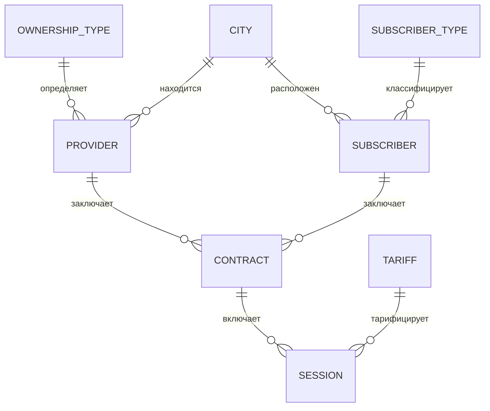

# Анализ предметной области (вариант Б-16)

Статус: предварительный анализ, выполнен до ЛР 2. Окончательная модель фиксируется в ЛР 2 (`labs/lab02/`), изменения решений — в `docs/decisions.md`.

## 1. Что автоматизируется

Учёт услуг доступа в Интернет, которые оказывают несколько фирм-провайдеров. В системе хранятся:
- фирмы-провайдеры;
- абоненты (физические лица и организации);
- договоры абонентов с провайдерами (один абонент может иметь несколько договоров, в том числе с разными провайдерами);
- сеансы связи по договорам (дата/время, объём в Мб, тариф со скидкой).

Кто пользуется системой (интерпретация, нужна для ролей): информационная система регионального объединения провайдеров. Сотрудники каждого провайдера ведут своих абонентов, договоры и сеансы; руководители провайдеров смотрят статистику по своей фирме; аналитический центр объединения видит сводку по всем провайдерам; администратор ведёт пользователей и справочники.

Основные процессы:
1. Регистрация провайдера (администратор).
2. Регистрация абонента и заключение договора с провайдером (оператор провайдера).
3. Регистрация сеансов связи по договору с автоматическим расчётом стоимости (оператор; в реальности — загрузка из биллинга, в курсовой — ввод и генерация).
4. Анализ: выручка, трафик, распределение по тарифам и типам абонентов по временным отрезкам (руководитель, главный аналитик).

## 2. Атрибуты из задания и их разбор

| Объект | Атрибут из задания | Замечание |
|---|---|---|
| Провайдер | название | уникально |
| | тип собственности | повторяющиеся значения → справочник |
| | адрес, телефон | адрес текстом; город вынести в справочник (решение D4) |
| | год начала работы | домен «год» |
| Абонент | ФИО или название предприятия | одно поле «наименование»; что это (ФИО или организация) определяется типом абонента |
| | тип (частное лицо, школа, ВУЗ, предприятие, …) | справочник с признаком «юридическое лицо» |
| | физический адрес, телефон | |
| | IP-адрес | по заданию у абонента, но IP выдаёт провайдер по конкретному договору → переносим в договор (решение D1) |
| Договор | абонент | FK |
| | (провайдер) | FK, неявно: «договоры, заключённые с ними» |
| | дата подключения | |
| | стоимость подключения | деньги |
| | стоимость 1 Мб информации | деньги, 4 знака после запятой |
| | (номер договора) | в задании нет, добавляем как естественный ключ для пользователя |
| Сеанс связи | дата и время сеанса | ключ секционирования |
| | количество Мб | > 0 |
| | тариф (бизнес-время — 100 %, вечерний — скидка 20 %, ночной — 50 %, …) | справочник со скидкой и временным окном |
| | (стоимость сеанса) | расчётный показатель, хранится снимком (решение D3) |

## 3. Сущности (пул сущностей по IDEF1X)

| № | Сущность | Таблица | Вид | Как появляется новый экземпляр |
|---|---|---|---|---|
| E1 | Тип собственности | `ref.ownership_type` | справочник | администратор вводит новый вид собственности |
| E2 | Город | `ref.city` | справочник | администратор при появлении провайдера/абонента из нового города |
| E3 | Тип абонента | `ref.subscriber_type` | справочник | администратор |
| E4 | Тариф | `ref.tariff` | справочник | администратор вводит тариф со скидкой и временным окном |
| E5 | Провайдер | `core.provider` | базовая | администратор регистрирует фирму |
| E6 | Абонент | `core.subscriber` | базовая | оператор при первом обращении лица/организации |
| E7 | Договор | `core.contract` | базовая (разрешает M:N провайдер–абонент) | оператор провайдера при подключении абонента |
| E8 | Сеанс связи | `core.session` | базовая, самая большая, секционируется | каждый сеанс выхода в сеть по договору |

Служебные (не из предметной области, нужны для требований курсовой):
- `sec.app_user` — привязка логина PostgreSQL к провайдеру и ФИО сотрудника (НЕ хранит пароли и НЕ определяет роль — роль определяется членством в группе PostgreSQL);
- `audit.change_log` — журнал изменений (`jsonb` old/new), связывает ЛР 7 с курсовой.

## 4. Связи

| № | Родитель | Потомок | Имя | Тип | Мощность | Удаление родителя |
|---|---|---|---|---|---|---|
| R1 | E1 Тип собственности | E5 Провайдер | определяет | обязат. неидентиф. | 0..N | RESTRICT |
| R2 | E2 Город | E5 Провайдер | находится в | обязат. неидентиф. | 0..N | RESTRICT |
| R3 | E2 Город | E6 Абонент | проживает/расположен в | обязат. неидентиф. | 0..N | RESTRICT |
| R4 | E3 Тип абонента | E6 Абонент | классифицирует | обязат. неидентиф. | 0..N | RESTRICT |
| R5 | E5 Провайдер | E7 Договор | заключает | обязат. неидентиф. | 0..N | RESTRICT (+ триггер-проверка) |
| R6 | E6 Абонент | E7 Договор | заключает | обязат. неидентиф. | 0..N | CASCADE (тест каскадного удаления) |
| R7 | E7 Договор | E8 Сеанс | включает | обязат. неидентиф. | 0..N | CASCADE |
| R8 | E4 Тариф | E8 Сеанс | тарифицирует | обязат. неидентиф. | 0..N | RESTRICT |

Провайдер ↔ Абонент — «многие-ко-многим», разрешается через Договор (у договора есть собственные атрибуты, поэтому это полноценная сущность, а не просто таблица пересечения).

## 5. Предварительная структура таблиц (уточняется в ЛР 2)

Домены: `d_name` varchar(150) NOT NULL непустой; `d_phone` varchar(20) CHECK по маске `^\+?[0-9 ()-]{7,20}$`; `d_money` numeric(12,2) ≥ 0; `d_price_mb` numeric(10,4) > 0; `d_year` smallint 1970..текущий; `d_percent` numeric(5,2) 0..100; `d_mb` numeric(12,3) > 0.

| Таблица | Поля |
|---|---|
| `ref.ownership_type` | `id` smallint identity PK; `name` d_name UNIQUE |
| `ref.city` | `id` int identity PK; `name` d_name UNIQUE |
| `ref.subscriber_type` | `id` smallint identity PK; `name` UNIQUE; `is_legal` boolean |
| `ref.tariff` | `id` smallint identity PK; `name` UNIQUE; `discount_pct` d_percent; `time_from` time; `time_to` time; `weekend` boolean; `description` text NULL |
| `core.provider` | `id` int identity PK; `name` UNIQUE; `ownership_type_id` FK; `city_id` FK; `address`; `phone` d_phone; `founded_year` d_year |
| `core.subscriber` | `id` int identity PK; `name`; `subscriber_type_id` FK; `city_id` FK; `address`; `phone` d_phone; `created_by` name DEFAULT session_user (для RLS, D5) |
| `core.contract` | `id` int identity PK; `provider_id` FK; `contract_no` varchar(20), UNIQUE(provider_id, contract_no); `subscriber_id` FK; `connected_on` date; `connection_fee` d_money; `price_per_mb` d_price_mb; `ip_address` inet; `closed_on` date NULL; `row_version` int (оптимистическая блокировка); номер договора по умолчанию из `core.contract_no_seq` (D12) |
| `core.session` | `id` bigint identity; `contract_id` FK; `started_at` timestamptz; `volume_mb` d_mb; `tariff_id` FK; `discount_pct` d_percent (снимок); `cost` d_money (снимок); PK(`id`, `started_at`); PARTITION BY RANGE(`started_at`) |

Индексы-кандидаты: `contract(provider_id)`, `contract(subscriber_id)`, `contract(connected_on)`, `session(contract_id, started_at)`, `session(started_at)` (ключ секционирования), `subscriber(lower(name) text_pattern_ops)` для поиска по маске, частичный уникальный `contract(provider_id, ip_address) WHERE closed_on IS NULL`.

## 6. Ограничения целостности (явные)

1. Сеанс не раньше даты подключения договора и не позже даты расторжения (если договор закрыт); не в будущем.
2. Дата подключения не раньше 1 января года начала работы провайдера.
3. Объём сеанса > 0; стоимость 1 Мб > 0; стоимость подключения ≥ 0; скидка 0..100 %.
4. Номер договора уникален в пределах провайдера; IP-адрес уникален среди действующих договоров провайдера.
5. Реквизиты договора (абонент, провайдер) после создания не меняются — только расторжение и новый договор.
6. Провайдера нельзя удалить, если по его договорам были сеансы за последние 12 месяцев.

## 7. Расчётные показатели (алгоритмические связи)

- Стоимость сеанса = `volume_mb × price_per_mb × (1 − discount_pct / 100)`, округление до копеек.
- Тариф сеанса (если не указан явно) = тариф, в чьё временное окно и тип дня (будни/выходные) попадает `started_at`.
- Выручка по договору за период = стоимость подключения (если `connected_on` в периоде) + Σ стоимость сеансов периода.
- Средняя эффективная цена 1 Мб = Σ cost / Σ volume_mb.

## 8. Объёмы данных (для генератора)

| Таблица | Кол-во | Требование |
|---|---|---|
| каждый справочник | 10–40 | ≥ 10 записей в каждом справочнике |
| `core.provider` | 25–40 | |
| `core.subscriber` | ≈ 8 000 | |
| `core.contract` | ≈ 12 000 | в сумме ≥ 10 000 псевдослучайных записей |
| `core.session` | 50 000 – 200 000 | ≥ 10 000–50 000; для ЛР 8 отдельные таблицы на ≥ 500 000 |

Период данных: 2024-01-01 … текущая дата (≥ 8 кварталов для секционирования и временных отрезков в статистике).
Справочник тарифов на 10 записей: будни (бизнес 09–18 0 %, вечерний 18–23 20 %, ночной 23–09 50 %), выходные (дневной 30 %, вечерний 40 %, ночной 60 %), праздничный, льготный образовательный, акционный, служебный (100 %). Окончательный набор — в ЛР 2/3.

## 9. Неоднозначности задания

Каждая — с рекомендуемым решением; окончательно фиксируются в `docs/decisions.md`, спорные показать преподавателю на ЛР 2.

| № | Вопрос | Рекомендация |
|---|---|---|
| Q1 | IP-адрес — у абонента или у договора? | У договора (D1). Обоснование: абонент с двумя договорами у разных провайдеров имеет два IP; иначе нарушается 3НФ/смысл. |
| Q2 | Тариф выбирается вручную или по времени сеанса? | По времени через триггер, с возможностью указать явно (D2). |
| Q3 | Хранить ли стоимость сеанса? | Да, снимок скидки и стоимости — осознанная денормализация (D3): иначе изменение справочника тарифов «переписывает» прошлую выручку. |
| Q4 | Город — справочник? | Да (D4): нужен для фильтров статистики и даёт ещё один справочник. |
| Q5 | Нужна ли роль «гость»? | Нет (D7 отменено 2026-09-29). |
| Q6 | Как делить сотрудников «по отделам»? | Сотрудник и руководитель привязаны к провайдеру; RLS по `provider_id` (D5). |
| Q7 | Расторжение договора | Добавить `closed_on` (NULL — действует). В задании нет, но нужно для «действующих договоров» и уникальности IP. |
| Q8 | Длительность сеанса | В задании нет; не вводим. Стоимость зависит только от объёма. |
| Q9 | «Модемная связь» | Устаревшее название; в интерфейсе — «сеанс связи», в ПЗ упомянуть как в задании. |
