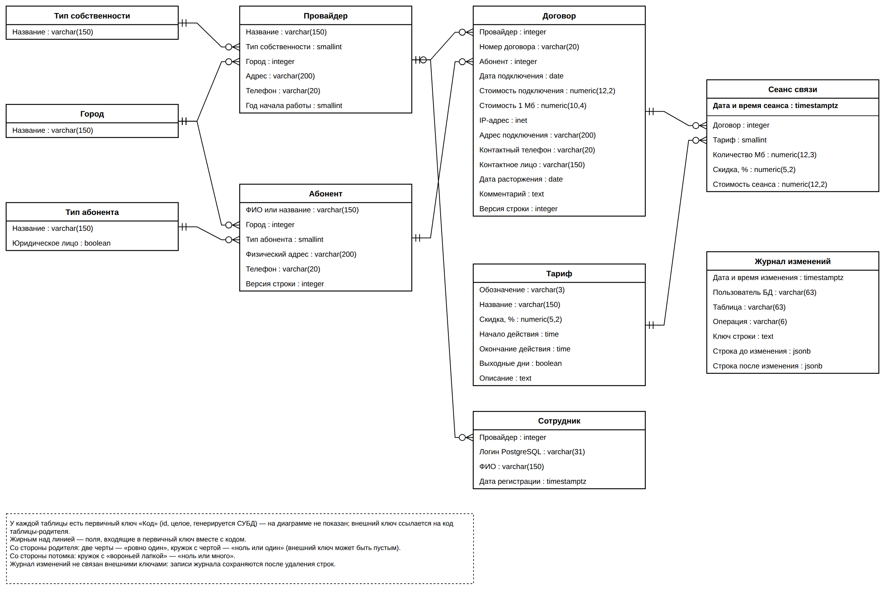

<!--
Модель БД варианта Б-16 (ЛР 2). Источник для раздела 4.1 ПЗ (отчёт по ЛР 2 не нужен, D16).
Синтаксис — tools/md2docx/README.md. Диаграммы — docs/diagrams/*.drawio (генерируются из er_model.yaml).
При изменении модели править: этот файл, docs/diagrams/er_model.yaml, docs/decisions.md.
-->

# Концептуальная модель базы данных (вариант Б-16)

## 1 Предметная область

Автоматизируется учёт услуг доступа в Интернет, которые оказывают несколько фирм-провайдеров. По заданию требуется хранить сведения:

- о фирмах-провайдерах: название, тип собственности (государственный, частный, ЗАО, ОАО и т. п.), адрес, телефон, год начала работы;
- о заключённых с ними договорах: абонент (ФИО или название предприятия, тип абонента — частное лицо, школа, вуз, предприятие и т. п., физический адрес, IP-адрес, телефон), дата подключения, стоимость подключения, стоимость 1 Мб информации;
- о сеансах связи: дата и время сеанса, количество Мб, тариф (бизнес-время — оплата 100 %, вечерний — скидка 20 %, ночной — скидка 50 % и т. п.).

Один абонент может заключать несколько договоров, в том числе с разными провайдерами. Абонент хранится в общем реестре объединения одной записью (решение D25): одно и то же лицо или предприятие, обслуживаемое двумя провайдерами, — один абонент с двумя договорами. Договор связывает абонента с провайдером, поэтому связь «провайдер — абонент» — «многие ко многим», реализованная через договор; сеансы относятся к договору.

## 2 Нормализация

### 2.1 Исходное отношение

Если хранить все сведения задания в одной таблице «Учёт сеансов», каждая строка описывает один сеанс и повторяет данные провайдера, абонента и договора. Фрагмент такого отношения приведён в таблице [@tab:flat].

Таблица: Исходное ненормализованное отношение «Учёт сеансов» (фрагмент, часть колонок) {#tab:flat}

| Провайдер | Тип собств. | Телефон пров. | Абонент | Тип абонента | IP-адрес | Дата подкл. | Цена 1 Мб | Дата и время сеанса | Мб | Тариф | Скидка, % |
|---|---|---|---|---|---|---|---|---|---|---|---|
| «ЛинкСеть» | ООО | +7 856 300-10-10 | Школа № 5 | школа | 10.1.5.20 | 01.09.2025 | 0,0800 | 02.09.2025 10:15 | 120 | Бизнес-время | 0 |
| «ЛинкСеть» | ООО | +7 856 300-10-10 | Школа № 5 | школа | 10.1.5.20 | 01.09.2025 | 0,0800 | 02.09.2025 23:40 | 800 | Ночной | 50 |
| «ЛинкСеть» | ООО | +7 856 300-10-10 | Петров И. И. | частное лицо | 10.1.7.3 | 15.03.2025 | 0,1000 | 02.09.2025 19:05 | 350 | Вечерний | 20 |

Такое отношение приводит к аномалиям:

- аномалия обновления — смена телефона провайдера или адреса абонента требует изменить все строки его сеансов, пропуск хотя бы одной строки делает данные противоречивыми;
- аномалия включения — нельзя зарегистрировать провайдера, абонента, договор или новый тариф, пока по ним нет ни одного сеанса;
- аномалия удаления — удаление последнего сеанса по договору уничтожает сведения о договоре, абоненте, а иногда и о провайдере;
- избыточность — одни и те же сведения о провайдере повторяются в десятках тысяч строк сеансов.

### 2.2 Первая нормальная форма

Отношение находится в 1НФ, если все значения атрибутов атомарны и нет повторяющихся групп. Для этого:

- повторяющаяся группа «сеансы договора» разворачивается в отдельные строки (одна строка — один сеанс);
- составной атрибут «адрес» разделяется на город и адрес в пределах города (улица, дом, офис): по городу строится статистика;
- «ФИО или название предприятия» хранится одним атрибутом «наименование абонента»: что именно в нём записано, определяет тип абонента;
- для однозначной идентификации договора вводится номер договора, уникальный в пределах провайдера (в задании не указан, но нужен пользователю для поиска договора).

Первичный ключ отношения в 1НФ — {Провайдер, Номер договора, Дата и время сеанса}.

### 2.3 Вторая нормальная форма

Отношение находится во 2НФ, если оно в 1НФ и каждый неключевой атрибут полностью функционально зависит от первичного ключа. В отношении 1НФ есть частичные зависимости:

- {Провайдер} → Тип собственности, Город, Адрес, Телефон, Год начала работы;
- {Провайдер, Номер договора} → Абонент и его реквизиты, Дата подключения, Стоимость подключения, Стоимость 1 Мб, IP-адрес, Адрес подключения, Контактный телефон, Контактное лицо;
- {Провайдер, Номер договора, Дата и время сеанса} → Количество Мб, Тариф, Скидка.

Устранение частичных зависимостей даёт три отношения: «Провайдер», «Договор», «Сеанс».

IP-адрес остаётся в договоре, а не переносится к абоненту. IP-адрес назначает провайдер при подключении по конкретному договору. Абонент может иметь несколько договоров (например, предприятие с несколькими точками подключения или с каналами у двух провайдеров), у каждого свой IP-адрес, и в отношении «Абонент» атрибут «IP-адрес» стал бы многозначным, что нарушает 1НФ (решение D1). По той же причине в договоре остаются адрес подключения, контактный телефон и контактное лицо: у разных договоров одного абонента они различаются (D25).

### 2.4 Третья нормальная форма

Отношение находится в 3НФ, если оно во 2НФ и неключевые атрибуты не зависят транзитивно от первичного ключа. Остаются транзитивные зависимости:

- в «Договоре»: {Провайдер, Номер договора} → Абонент → Тип абонента, Город, Адрес, Телефон абонента. Сведения об абоненте выносятся в отдельное отношение «Абонент», договор ссылается на него. Отношение «Абонент» от провайдера не зависит: это общий реестр, а связь с провайдером даёт договор (D25);
- в «Сеансе»: {…} → Тариф → Скидка, временное окно тарифа. Тарифы выносятся в справочник «Тариф».

Кроме устранения зависимостей, повторяющиеся значения с ограниченным набором вынесены в справочники «Тип собственности», «Тип абонента», «Город». Это не требование 3НФ, а мера для целостности: значение выбирается из списка, а не вводится текстом, и опечатки вроде «ЗАО» / «З.А.О.» исключены.

Для всех отношений введены суррогатные первичные ключи `id`. Естественные ключи длинные (название провайдера), могут меняться (переименование фирмы) или уникальны только в паре с другим атрибутом (номер договора), поэтому они оставлены альтернативными ключами.

### 2.5 Обоснованная денормализация

В сеансе, кроме ссылки на тариф, хранятся скидка `discount_pct` и стоимость `cost` на момент регистрации сеанса (решение D3). Скидка транзитивно зависит от тарифа, а стоимость вычисляется по формуле «объём × цена 1 Мб × (1 − скидка / 100)», то есть формально это отступление от 3НФ. Оно обосновано:

- изменение скидки в справочнике тарифов или цены 1 Мб в договоре не должно менять стоимость уже оказанных услуг — это исторические финансовые данные;
- отчёты о выручке строятся по десяткам и сотням тысяч сеансов; хранение стоимости избавляет от соединения трёх таблиц и вычисления формулы для каждой строки;
- значения заполняются только триггером при вставке сеанса и не редактируются пользователем, поэтому аномалии обновления не возникают.

## 3 Сущности

Пул сущностей приведён в таблице [@tab:entities].

Таблица: Пул сущностей {#tab:entities}

| № | Сущность | Таблица | Вид | Определение | Как появляется экземпляр |
|---|---|---|---|---|---|
| E1 | Тип собственности | `ref.ownership_type` | справочник | Организационно-правовая форма или форма собственности провайдера | Администратор вводит новый вид собственности |
| E2 | Город | `ref.city` | справочник | Населённый пункт, в котором расположен провайдер или абонент | Администратор при регистрации провайдера или абонента из нового города |
| E3 | Тип абонента | `ref.subscriber_type` | справочник | Категория абонента: частное лицо, школа, вуз, предприятие и т. п. | Администратор |
| E4 | Тариф | `ref.tariff` | справочник | Условия оплаты сеанса: скидка и время действия | Администратор вводит тариф со скидкой и временным окном |
| E5 | Провайдер | `core.provider` | базовая | Фирма, оказывающая услуги доступа в Интернет | Администратор регистрирует фирму |
| E6 | Абонент | `core.subscriber` | базовая | Физическое лицо или организация — получатель услуг одного или нескольких провайдеров (общий реестр) | Оператор вместе с первым договором, если такого абонента ещё нет в реестре |
| E7 | Договор | `core.contract` | базовая, таблица пересечения | Соглашение абонента с провайдером о подключении; хранит данные подключения у этого провайдера | Оператор провайдера при подключении абонента |
| E8 | Сеанс связи | `core.session` | базовая | Один выход абонента в сеть по договору | Регистрация сеанса по договору (оператор или загрузка из биллинга) |
| E9 | Сотрудник | `sec.app_user` | служебная | Пользователь системы: логин PostgreSQL, ФИО, провайдер, в котором работает | Администратор при создании учётной записи |
| E10 | Журнал изменений | `audit.change_log` | служебная | Запись об одном изменении строки основной таблицы | Триггер при вставке, изменении или удалении строки |
| E11 | Пользователь или группа | `pg_catalog.pg_authid` | системная | Роль PostgreSQL: пользователь (с правом входа) или группа пользователей | Администратор создаёт сотрудника — функция выполняет `CREATE ROLE … LOGIN` |
| E12 | Членство в группе | `pg_catalog.pg_auth_members` | системная, таблица пересечения | Факт вхождения пользователя в группу (роль в системе) | Функция администратора выполняет `GRANT grp_… TO логин` |

Служебные сущности не описаны в задании, но нужны для требований к курсовому проекту. «Сотрудник» связывает учётную запись PostgreSQL с провайдером для разграничения доступа к строкам (D5). В этой таблице нет паролей и нет роли пользователя: пароли хранит только PostgreSQL, а роль определяется членством учётной записи в группе PostgreSQL. «Журнал изменений» хранит старую и новую версии строки в формате `jsonb` (D10).

### 3.1 Пользователи и группы — системные таблицы PostgreSQL

Своей таблицы пользователей и паролей в базе нет: пользователи и группы — это роли PostgreSQL, они хранятся в системном каталоге (схема `pg_catalog`). На рисунке концептуальной модели (`labs/lab02/screenshots/concept_model.drawio.png`, исходник `docs/diagrams/concept_model.drawio`) системные таблицы не показаны: их ведёт СУБД, а структура приведена ниже.

Таблица: Пользователи и группы — `pg_authid` {#tab:pg-authid}

| Поле на схеме | Колонка | Тип | Смысл |
|---|---|---|---|
| Код роли (ПК) | `oid` | oid | внутренний идентификатор роли |
| Имя роли (логин) | `rolname` | name | имя пользователя или группы, уникально (альтернативный ключ) |
| Суперпользователь | `rolsuper` | boolean | обходит все проверки прав; у пользователей системы — нет |
| Наследует права групп | `rolinherit` | boolean | получает права групп, в которые входит, без SET ROLE |
| Может создавать роли | `rolcreaterole` | boolean | право создавать и изменять роли; у пользователей системы — нет (сотрудников создаёт функция администратора) |
| Может создавать базы данных | `rolcreatedb` | boolean | право CREATE DATABASE |
| Может входить в систему | `rolcanlogin` | boolean | да — пользователь (LOGIN), нет — группа |
| Репликация | `rolreplication` | boolean | право подключаться для репликации |
| Обходит политики RLS | `rolbypassrls` | boolean | игнорирует политики строк; у пользователей системы — нет |
| Лимит подключений | `rolconnlimit` | integer | число одновременных подключений, −1 — без ограничения |
| Пароль (хеш SCRAM-SHA-256) | `rolpassword` | text | хеш пароля; сам пароль нигде не хранится |
| Пароль действует до | `rolvaliduntil` | timestamptz | срок действия пароля, NULL — бессрочно |

Таблица: Членство в группах — `pg_auth_members` {#tab:pg-auth-members}

| Поле на схеме | Колонка | Тип | Смысл |
|---|---|---|---|
| Код записи (ПК) | `oid` | oid | идентификатор записи о членстве |
| Код группы (ВК) | `roleid` | oid | группа (`grp_admin`, `grp_operator`, `grp_manager`, `grp_chief`) |
| Код участника (ВК) | `member` | oid | пользователь, входящий в группу |
| Кто выдал членство (ВК) | `grantor` | oid | роль, выполнившая GRANT (служебное поле) |
| Может управлять группой | `admin_option` | boolean | право добавлять в группу и исключать из неё (WITH ADMIN OPTION) |
| Наследует права группы | `inherit_option` | boolean | права группы действуют без SET ROLE |
| Может переключаться в группу | `set_option` | boolean | разрешено SET ROLE на группу |

`pg_auth_members` — таблица пересечения: связь «многие ко многим» ролей с ролями (пользователь может входить в несколько групп, в группе много пользователей). Роль пользователя в системе определяется именно этими строками: например, оператор — пользователь, для которого есть строка с группой `grp_operator`. Обе таблицы ведёт сама СУБД командами `CREATE ROLE`, `ALTER ROLE`, `GRANT … TO …`, `DROP ROLE`; прямой доступ к `pg_authid` есть только у суперпользователя, остальным доступно представление `pg_roles` (пароль в нём скрыт).

Связь «Сотрудник — Пользователь» логическая: внешний ключ на системный каталог поставить нельзя, поэтому логин сотрудника совпадает с именем роли, а соответствие проверяет функция администратора при создании сотрудника.

## 4 Связи

Матрица связей приведена в таблице [@tab:rel-matrix], описание связей — в таблице [@tab:relations]. Все связи — неидентифицирующие: у потомка собственный суррогатный ключ, внешний ключ в него не входит. Журнал изменений (E10) внешними ключами ни с чем не связан: записи журнала должны сохраняться и после удаления строк, на которые они ссылаются, поэтому таблица и ключ строки записываются значениями.

Таблица: Матрица связей (строка — родитель, столбец — потомок) {#tab:rel-matrix}

| Родитель \ Потомок | E5 Провайдер | E6 Абонент | E7 Договор | E8 Сеанс | E9 Сотрудник |
|---|---|---|---|---|---|
| E1 Тип собственности | R1 | | | | |
| E2 Город | R2 | R3 | | | |
| E3 Тип абонента | | R4 | | | |
| E4 Тариф | | | | R8 | |
| E5 Провайдер | | | R5 | | R9 |
| E6 Абонент | | | R6 | | |
| E7 Договор | | | | R7 | |

Таблица: Описание связей {#tab:relations}

| № | Родитель | Потомок | Имя связи | Тип | Мощность | При удалении родителя |
|---|---|---|---|---|---|---|
| R1 | Тип собственности | Провайдер | определяет | неидентифицирующая, обязательная | 1 : 0..N | запрет (RESTRICT) |
| R2 | Город | Провайдер | находится в | неидентифицирующая, обязательная | 1 : 0..N | запрет |
| R3 | Город | Абонент | расположен в | неидентифицирующая, обязательная | 1 : 0..N | запрет |
| R4 | Тип абонента | Абонент | классифицирует | неидентифицирующая, обязательная | 1 : 0..N | запрет |
| R5 | Провайдер | Договор | заключает | неидентифицирующая, обязательная | 1 : 0..N | запрет |
| R6 | Абонент | Договор | заключает | неидентифицирующая, обязательная | 1 : 0..N | каскадное удаление (CASCADE) |
| R7 | Договор | Сеанс | включает | неидентифицирующая, обязательная | 1 : 0..N | каскадное удаление |
| R8 | Тариф | Сеанс | тарифицирует | неидентифицирующая, обязательная | 1 : 0..N | запрет |
| R9 | Провайдер | Сотрудник | нанимает | неидентифицирующая, необязательная | 0..1 : 0..N | запрет |
| R10 | Пользователь (E11) | Сотрудник | является учётной записью | логическая (без FK), по имени роли | 1 : 0..1 | удаление сотрудника удаляет роль (функция) |
| R11 | Пользователь или группа (E11) | Членство в группе | входит в | системная | 1 : 0..N | каскадно (DROP ROLE) |

Связь «многие ко многим» провайдеров с абонентами реализована через договор: у провайдера много договоров (R5), у абонента — тоже (R6), абонент может быть клиентом нескольких провайдеров (D25). Связь «многие ко многим» пользователей с группами — через системную таблицу «Членство в группе». Системная таблица ссылается на «Пользователей и группы» тремя полями — группа, участник и роль, выдавшая членство. Связи R10 и R11 в матрицу и на концептуальную схему не включены: это связи с системными таблицами, их ведёт СУБД.

Правила удаления выбраны так: справочную запись нельзя удалить, пока на неё ссылаются. Удаление абонента удаляет его договоры и сеансы: это демонстрирует каскадное удаление и соответствует ситуации «абонент исключён из базы». Абонента, у которого есть договоры с другими провайдерами, удалить через приложение нельзя: каскадом ушли бы чужие договоры (D25). Провайдера удалить нельзя, пока у него есть договоры (решение D9) или сотрудники. Связь R9 необязательная: администратор и главный аналитик объединения не работают у конкретного провайдера, у них ссылка на провайдера пустая.

## 5 Домены

Повторяющиеся ограничения значений оформлены доменами (таблица [@tab:domains]).

Таблица: Домены {#tab:domains}

| Домен | Базовый тип | Ограничение | Где используется |
|---|---|---|---|
| `d_name` | varchar(150) | непустая строка без пробелов по краям | наименования во всех таблицах |
| `d_address` | varchar(200) | непустая строка | адрес провайдера и абонента, адрес подключения |
| `d_phone` | varchar(20) | только цифры, пробел, скобки, дефис и «+» в начале; не меньше 7 цифр (проверка `translate()`, D24) | телефоны |
| `d_year` | smallint | от 1970 до 2100; не позже текущего года — проверка в таблице | год начала работы провайдера |
| `d_contract_no` | varchar(20) | непустая строка без пробелов по краям | номер договора |
| `d_login` | varchar(31) | от 3 символов: строчная латинская буква, затем строчные буквы, цифры, «_» (проверка `translate()`, D24) | логин сотрудника (имя роли PostgreSQL) |
| `d_money` | numeric(12,2) | не меньше 0 | стоимость подключения, стоимость сеанса |
| `d_price_mb` | numeric(10,4) | больше 0 | стоимость 1 Мб |
| `d_percent` | numeric(5,2) | от 0 до 100 | скидка тарифа и сеанса |
| `d_mb` | numeric(12,3) | больше 0 | объём сеанса, Мб |

Типы выбраны так: денежные величины — `numeric` (точная десятичная арифметика, без ошибок округления `float` и без зависимости от локали, как у `money`); стоимость 1 Мб — четыре знака после запятой, потому что цена за мегабайт меньше копейки; дата и время сеанса — `timestamptz` (момент времени с часовым поясом); IP-адрес — встроенный тип `inet` (проверка формата, поддержка IPv4 и IPv6, сравнение адресов).

## 6 Атрибуты и ключи

Атрибуты сущностей, их домены и роль в ключах приведены в таблице [@tab:attributes]. Обозначения: PK — первичный ключ, FK — внешний ключ, AK — альтернативный ключ (уникальность).

Таблица: Атрибуты сущностей {#tab:attributes}

| Сущность | Атрибут | Колонка | Домен / тип | NULL | Ключ |
|---|---|---|---|---|---|
| Тип собственности | Идентификатор | `id` | smallint | NOT NULL | PK |
| | Наименование | `name` | `d_name` | NOT NULL | AK |
| Город | Идентификатор | `id` | integer | NOT NULL | PK |
| | Наименование | `name` | `d_name` | NOT NULL | AK |
| Тип абонента | Идентификатор | `id` | smallint | NOT NULL | PK |
| | Наименование | `name` | `d_name` | NOT NULL | AK |
| | Юридическое лицо | `is_legal` | boolean | NOT NULL | |
| Тариф | Идентификатор | `id` | smallint | NOT NULL | PK |
| | Обозначение (Б, В, Н…) | `code` | varchar(3) | NOT NULL | AK |
| | Наименование | `name` | `d_name` | NOT NULL | AK |
| | Скидка, % | `discount_pct` | `d_percent` | NOT NULL | |
| | Начало действия | `time_from` | time | NULL | |
| | Окончание действия | `time_to` | time | NULL | |
| | Выходные дни | `is_weekend` | boolean | NULL | |
| | Описание | `description` | text | NULL | |
| Провайдер | Идентификатор | `id` | integer | NOT NULL | PK |
| | Название | `name` | `d_name` | NOT NULL | AK |
| | Тип собственности | `ownership_type_id` | smallint | NOT NULL | FK → E1 |
| | Город | `city_id` | integer | NOT NULL | FK → E2 |
| | Адрес | `address` | `d_address` | NOT NULL | |
| | Телефон | `phone` | `d_phone` | NOT NULL | |
| | Год начала работы | `founded_year` | `d_year` | NOT NULL | |
| Абонент | Идентификатор | `id` | integer | NOT NULL | PK |
| | ФИО или название предприятия | `name` | `d_name` | NOT NULL | AK (с телефоном) |
| | Тип абонента | `subscriber_type_id` | smallint | NOT NULL | FK → E3 |
| | Город | `city_id` | integer | NOT NULL | FK → E2 |
| | Физический адрес | `address` | `d_address` | NOT NULL | |
| | Телефон | `phone` | `d_phone` | NOT NULL | AK (с наименованием) |
| | Версия строки (служебный) | `row_version` | integer | NOT NULL | |
| Договор | Идентификатор | `id` | integer | NOT NULL | PK |
| | Провайдер | `provider_id` | integer | NOT NULL | FK → E5, AK1, AK2 |
| | Номер договора | `contract_no` | `d_contract_no` | NOT NULL | AK1 |
| | Абонент | `subscriber_id` | integer | NOT NULL | FK → E6 |
| | Дата подключения | `connected_on` | date | NOT NULL | |
| | Стоимость подключения | `connection_fee` | `d_money` | NOT NULL | |
| | Стоимость 1 Мб | `price_per_mb` | `d_price_mb` | NOT NULL | |
| | IP-адрес | `ip_address` | inet | NOT NULL | AK2 (для действующих) |
| | Адрес подключения | `connection_address` | `d_address` | NOT NULL | |
| | Контактный телефон | `contact_phone` | `d_phone` | NULL | |
| | Контактное лицо | `contact_person` | `d_name` | NULL | |
| | Дата расторжения | `closed_on` | date | NULL | |
| | Комментарий | `note` | text | NULL | |
| | Версия строки (служебный) | `row_version` | integer | NOT NULL | |
| Сеанс связи | Идентификатор | `id` | bigint | NOT NULL | PK |
| | Дата и время сеанса | `started_at` | timestamptz | NOT NULL | PK |
| | Договор | `contract_id` | integer | NOT NULL | FK → E7 |
| | Тариф | `tariff_id` | smallint | NOT NULL | FK → E4 |
| | Количество Мб | `volume_mb` | `d_mb` | NOT NULL | |
| | Скидка на момент сеанса, % | `discount_pct` | `d_percent` | NOT NULL | |
| | Стоимость сеанса | `cost` | `d_money` | NOT NULL | |
| Сотрудник | Идентификатор | `id` | integer | NOT NULL | PK |
| | Логин PostgreSQL | `login` | `d_login` | NOT NULL | AK |
| | ФИО | `full_name` | `d_name` | NOT NULL | |
| | Провайдер | `provider_id` | integer | NULL | FK → E5 |
| | Дата регистрации | `created_at` | timestamptz | NOT NULL | |
| | Выдан временный пароль | `reset_pending` | boolean | NOT NULL | |
| | Когда выдан временный пароль | `reset_at` | timestamptz | NULL | |
| | Кто выдал временный пароль | `reset_by` | `d_login` | NULL | |
| Журнал изменений | Идентификатор | `id` | bigint | NOT NULL | PK |
| | Дата и время изменения | `changed_at` | timestamptz | NOT NULL | |
| | Пользователь БД | `db_user` | varchar(63) | NOT NULL | |
| | Таблица | `table_name` | varchar(63) | NOT NULL | |
| | Операция | `operation` | varchar(6) | NOT NULL | |
| | Ключ строки | `row_pk` | text | NOT NULL | |
| | Строка до изменения | `old_row` | jsonb | NULL | |
| | Строка после изменения | `new_row` | jsonb | NULL | |

Первичные ключи всех таблиц — суррогатные, генерируются СУБД (`GENERATED ALWAYS AS IDENTITY`). У сеанса первичный ключ составной {`id`, `started_at`}: таблица сеансов будет секционирована по дате (ЛР 8), а в PostgreSQL первичный ключ секционированной таблицы обязан включать ключ секционирования.

Альтернативные ключи:

- названия в справочниках и название провайдера уникальны; обозначение тарифа уникально (D20);
- логин сотрудника уникален (совпадает с именем роли PostgreSQL);
- абонент в реестре один: наименование без учёта регистра вместе с цифрами телефона уникальны (уникальный индекс по выражению, D25) — так «+7 949 123-45-67» и «79491234567» считаются одним телефоном;
- AK1 договора — {`provider_id`, `contract_no`}: номер договора уникален в пределах провайдера, у разных провайдеров номера могут совпадать;
- AK2 договора — {`provider_id`, `ip_address`} только для действующих договоров (`closed_on IS NULL`): провайдер не может выдать один IP двум абонентам одновременно, но после расторжения договора адрес освобождается. Реализуется частичным уникальным индексом.

Одно наименование абонента не уникально (однофамильцы), поэтому альтернативный ключ абонента — наименование вместе с телефоном.

## 7 Даталогическая модель

Таблицы базы данных и связи между ними показаны на рисунке [@fig:er-logical], структура таблиц — в таблицах [@tab:dl-ref] – [@tab:dl-change-log].

{#fig:er-logical}

Таблица: Справочники ref.ownership_type, ref.city, ref.subscriber_type {#tab:dl-ref}

| Таблица | Колонка | Тип | Обязательность | Ключ | По умолчанию / правило |
|---|---|---|---|---|---|
| `ref.ownership_type` | `id` | smallint | NOT NULL | PK | identity |
| | `name` | `d_name` | NOT NULL | UNIQUE | |
| `ref.city` | `id` | integer | NOT NULL | PK | identity |
| | `name` | `d_name` | NOT NULL | UNIQUE | |
| `ref.subscriber_type` | `id` | smallint | NOT NULL | PK | identity |
| | `name` | `d_name` | NOT NULL | UNIQUE | |
| | `is_legal` | boolean | NOT NULL | | false |

Таблица: Справочник ref.tariff {#tab:dl-tariff}

| Колонка | Тип | Обязательность | Ключ | По умолчанию / правило |
|---|---|---|---|---|
| `id` | smallint | NOT NULL | PK | identity |
| `code` | varchar(3) | NOT NULL | UNIQUE | 1–3 прописные кириллические буквы (D20) |
| `name` | `d_name` | NOT NULL | UNIQUE | |
| `discount_pct` | `d_percent` | NOT NULL | | 0 |
| `time_from` | time | NULL | | NULL — тариф назначается только вручную |
| `time_to` | time | NULL | | задаётся вместе с `time_from`; окно через полночь, если `time_from > time_to` |
| `is_weekend` | boolean | NULL | | true — выходные, false — будни, NULL — любой день |
| `description` | text | NULL | | |

Таблица: Таблица core.provider {#tab:dl-provider}

| Колонка | Тип | Обязательность | Ключ | Ссылка, при удалении родителя |
|---|---|---|---|---|
| `id` | integer | NOT NULL | PK | identity |
| `name` | `d_name` | NOT NULL | UNIQUE | |
| `ownership_type_id` | smallint | NOT NULL | FK | `ref.ownership_type`, RESTRICT |
| `city_id` | integer | NOT NULL | FK | `ref.city`, RESTRICT |
| `address` | `d_address` | NOT NULL | | |
| `phone` | `d_phone` | NOT NULL | | |
| `founded_year` | `d_year` | NOT NULL | | не позже текущего года |

Таблица: Таблица core.subscriber {#tab:dl-subscriber}

| Колонка | Тип | Обязательность | Ключ | Ссылка, при удалении родителя |
|---|---|---|---|---|
| `id` | integer | NOT NULL | PK | identity |
| `name` | `d_name` | NOT NULL | UNIQUE (с `phone`) | уникальна пара «`lower(name)`, цифры `phone`» (D25) |
| `city_id` | integer | NOT NULL | FK | `ref.city`, RESTRICT |
| `subscriber_type_id` | smallint | NOT NULL | FK | `ref.subscriber_type`, RESTRICT |
| `address` | `d_address` | NOT NULL | | |
| `phone` | `d_phone` | NOT NULL | UNIQUE (с `name`) | |
| `row_version` | integer | NOT NULL | | служебная: версия строки, 1; оптимистическая блокировка (D8) |

Таблица: Таблица core.contract {#tab:dl-contract}

| Колонка | Тип | Обязательность | Ключ | Ссылка, при удалении родителя / правило |
|---|---|---|---|---|
| `id` | integer | NOT NULL | PK | identity |
| `provider_id` | integer | NOT NULL | FK, AK1, AK2 | `core.provider`, RESTRICT |
| `contract_no` | `d_contract_no` | NOT NULL | AK1 | по умолчанию формируется из последовательности (D12) |
| `subscriber_id` | integer | NOT NULL | FK | `core.subscriber`, CASCADE |
| `connected_on` | date | NOT NULL | | текущая дата; не раньше года основания провайдера |
| `connection_fee` | `d_money` | NOT NULL | | |
| `price_per_mb` | `d_price_mb` | NOT NULL | | |
| `ip_address` | inet | NOT NULL | AK2 | уникален среди действующих договоров провайдера |
| `connection_address` | `d_address` | NOT NULL | | адрес подключения у этого провайдера; по умолчанию — адрес абонента (D25) |
| `contact_phone` | `d_phone` | NULL | | контактный телефон по этому договору (D25) |
| `contact_person` | `d_name` | NULL | | контактное лицо по этому договору (D25) |
| `closed_on` | date | NULL | | NULL — договор действует; не раньше `connected_on` |
| `note` | text | NULL | | комментарий оператора (D21) |
| `row_version` | integer | NOT NULL | | служебная: версия строки, 1; увеличивается при каждом изменении — оптимистическая блокировка (D8) |

Таблица: Таблица core.session {#tab:dl-session}

| Колонка | Тип | Обязательность | Ключ | Ссылка, при удалении родителя / правило |
|---|---|---|---|---|
| `id` | bigint | NOT NULL | PK | identity |
| `started_at` | timestamptz | NOT NULL | PK | ключ секционирования; в периоде действия договора, не в будущем |
| `contract_id` | integer | NOT NULL | FK | `core.contract`, CASCADE |
| `tariff_id` | smallint | NOT NULL | FK | `ref.tariff`, RESTRICT; если не указан — подбирается по времени сеанса (D2) |
| `volume_mb` | `d_mb` | NOT NULL | | |
| `discount_pct` | `d_percent` | NOT NULL | | копия скидки тарифа на момент сеанса (D3) |
| `cost` | `d_money` | NOT NULL | | `volume_mb × price_per_mb × (1 − discount_pct / 100)`, вычисляется при вставке (D3) |

Таблица: Служебная таблица sec.app_user {#tab:dl-app-user}

| Колонка | Тип | Обязательность | Ключ | Ссылка, при удалении родителя / правило |
|---|---|---|---|---|
| `id` | integer | NOT NULL | PK | identity |
| `login` | `d_login` | NOT NULL | UNIQUE | имя LOGIN-роли PostgreSQL |
| `full_name` | `d_name` | NOT NULL | | |
| `provider_id` | integer | NULL | FK | `core.provider`, RESTRICT; обязателен для операторов и руководителей провайдера, пуст для администратора и главного аналитика |
| `created_at` | timestamptz | NOT NULL | | текущие дата и время |
| `reset_pending` | boolean | NOT NULL | | false; true — выдан временный пароль, до смены работа недоступна (D27) |
| `reset_at` | timestamptz | NULL | | когда выдан временный пароль |
| `reset_by` | `d_login` | NULL | | логин администратора, выдавшего временный пароль; самого пароля в таблице нет |

Таблица: Служебная таблица audit.change_log {#tab:dl-change-log}

| Колонка | Тип | Обязательность | Ключ | Правило |
|---|---|---|---|---|
| `id` | bigint | NOT NULL | PK | identity |
| `changed_at` | timestamptz | NOT NULL | | текущие дата и время |
| `db_user` | varchar(63) | NOT NULL | | `session_user` — кто выполнил изменение |
| `table_name` | varchar(63) | NOT NULL | | схема и имя изменённой таблицы |
| `operation` | varchar(6) | NOT NULL | | INSERT, UPDATE или DELETE |
| `row_pk` | text | NOT NULL | | значение первичного ключа изменённой строки |
| `old_row` | jsonb | NULL | | строка до изменения; пусто при INSERT |
| `new_row` | jsonb | NULL | | строка после изменения; пусто при DELETE |

Первичные ключи не изменяются, поэтому для всех внешних ключей правило при изменении родителя — NO ACTION.

Служебная колонка `row_version` договора и абонента не относится к предметной области: она нужна для обнаружения одновременного изменения строки двумя пользователями (D8). Провайдер определяется договором: оператор видит абонента, пока у его провайдера есть договор с этим абонентом, а договоры и сеансы — только своего провайдера (D25). В таблице сотрудников нет паролей и нет поля роли: пароли хранит PostgreSQL, роль пользователя определяется его членством в группе PostgreSQL (`grp_admin`, `grp_operator`, `grp_manager`, `grp_chief`).

## 8 Ограничения целостности

Кроме ключей и доменов, модель содержит ограничения, которые проверяются в СУБД (CHECK-ограничения и триггеры, реализуются в ЛР 3 и на этапе триггеров):

1. Дата и время сеанса — не раньше даты подключения договора, не позже даты расторжения (если договор расторгнут) и не в будущем.
2. Дата подключения — не раньше 1 января года начала работы провайдера.
3. Дата расторжения — не раньше даты подключения.
4. Провайдер и абонент договора после создания не меняются: при смене условий договор расторгается и заключается новый.
5. У тарифа время начала и окончания задаются вместе или оба не задаются; окна автоматически назначаемых тарифов одного типа дня не пересекаются.
6. Провайдера нельзя удалить, если у него есть договоры.

## 9 Справочник тарифов

Задание перечисляет тарифы с примерами скидок. Предлагаемое наполнение справочника приведено в таблице [@tab:tariffs]: тарифы с временным окном назначаются сеансу автоматически по времени его начала, тарифы без окна — только явно.

Таблица: Наполнение справочника тарифов {#tab:tariffs}

| Обозначение | Тариф | Дни | Время | Скидка, % |
|---|---|---|---|---|
| Б | Бизнес-время | будни | 09:00–18:00 | 0 |
| В | Вечерний | будни | 18:00–23:00 | 20 |
| Н | Ночной | будни | 23:00–09:00 | 50 |
| ВД | Выходной дневной | выходные | 09:00–18:00 | 30 |
| ВВ | Выходной вечерний | выходные | 18:00–23:00 | 40 |
| ВН | Выходной ночной | выходные | 23:00–09:00 | 60 |
| П | Праздничный | — | вручную | 50 |
| О | Образовательный | — | вручную (школы и вузы) | 70 |
| А | Акционный | — | вручную | 25 |
| С | Служебный | — | вручную | 100 |

## 10 Отступления от формулировки задания

Таблица: Отступления от задания и их обоснование {#tab:deviations}

| Что в задании | Что в модели | Обоснование |
|---|---|---|
| IP-адрес — атрибут абонента | IP-адрес — атрибут договора | IP назначает провайдер по договору; у абонента с несколькими договорами несколько IP (D1) |
| Адрес — один атрибут | Город (справочник) + адрес | Статистика и фильтры по городам (D4) |
| Номера договора нет | `contract_no`, уникален в пределах провайдера | Пользователю нужен понятный идентификатор договора вместо внутреннего `id` |
| Расторжения договора нет | `closed_on` | Нужен для уникальности IP среди действующих договоров и отбора действующих договоров |
| Стоимости сеанса нет | `discount_pct`, `cost` в сеансе | Обоснованная денормализация (D3), п. 2.5 |
| Привязка абонента к провайдеру не указана | Общий реестр абонентов; связь с провайдером — через договор; адрес подключения и контакты — в договоре | Одно лицо у двух провайдеров — одна запись без дублей; различающиеся у провайдеров данные хранятся в договоре; провайдер видит только абонентов, с которыми у него есть договор (D25) |
| Тариф — название и скидка | + временное окно и тип дня | Тариф сеанса определяется по времени автоматически (D2) |
